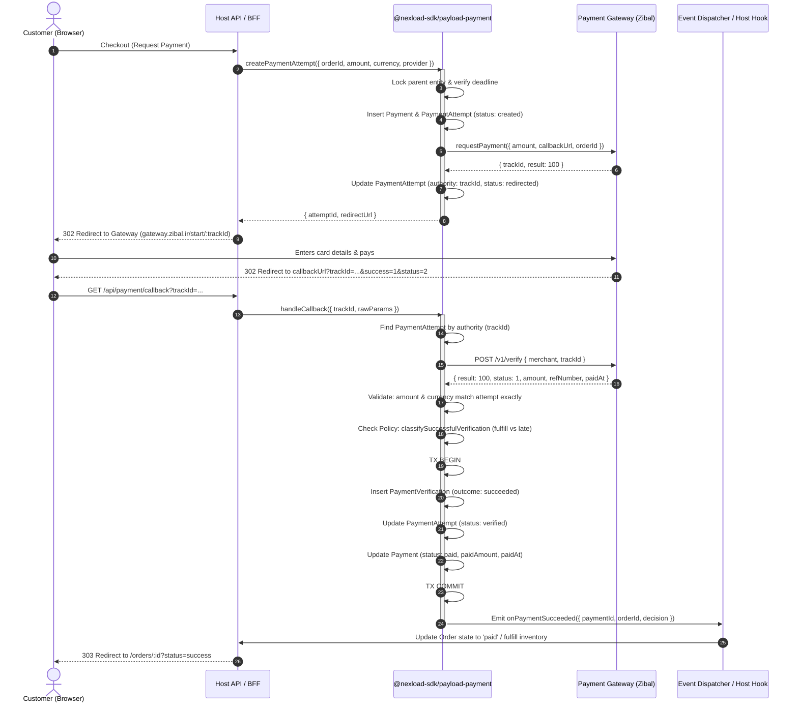

# Payment Module Architecture & Design Specification

- **Date:** 2026-11-22
- **Author:** Antigravity (Google DeepMind)
- **Status:** Draft / RFC
- **Target Packages:** `@nexload-sdk/payment` (v1.0.0, core runtime-agnostic) & `@nexload-sdk/payload-payment` (v1.0.0, Payload CMS plugin)
- **Governing Constraints:** `docs/research/recurring-patterns/SPEC-BRIEF.md` ("Fixed decisions" section is binding)

---

## 1. Problem & Empirical Evidence

### 1.1 The Cross-Repository Problem
Across 5 production and prototype codebases (`nexload-e-commerce`, `choobinooo.ir`, `faralist.com`, `cloud-app`, `gecut_kartbook`), payment processing has been reimplemented 5 times with diverging abstractions, incomplete concurrency guards, and recurring currency-unit bugs (Synthesis report `docs/research/recurring-patterns/SYNTHESIS.md#L21-L23`, `reports/B2-faralist.md#L19-L20`).

Key recurring failure surfaces identified in empirical codebases:
1. **Currency Confusion (The #1 Bug Surface):** Standard platform currencies fluctuate between Toman (`IRT`) and Rial (`IRR`). Zibal's wire contract strictly mandates Rials (`IRR`), while billing services frequently store Tomans. In `faralist.com` (`packages/billing/src/index.ts#L484-L485`), amounts are multiplied by 10 for Zibal; in `nexload-e-commerce` (`apps/api/src/modules/payments/payment-verification.ts#L6-L9`), verify amounts must check `verification.amount % 10 === 0` before dividing by 10; in `choobinooo.ir` (`apps/api/src/rpc/services/payment/zibal.client.ts#L27-L33`), helper functions `tomanToRial` and `rialToToman` are manually scattered; and in `cloud-app` (`packages/payment/src/index.ts#L171-L172`), `amountRials` and `amountToman` coexist on verification DTOs.
2. **Missing Attempt/Verification Split:** In `choobinooo.ir` (`apps/api/src/rpc/services/payment.service.ts#L154-L202`), each payment redirect overwrites the previous attempt on a single `payments` collection row, marking previous attempts `FAILED` with `failureReason: "superseded-by-new-payment-attempt"`, destroying auditability.
3. **Host Mutation Coupled to Payment Verification:** In `choobinooo.ir` (`apps/api/src/rpc/services/payment.service.ts#L322-L404`), verifying a transaction directly executes order status transitions (`applyOrderTransition`) inside the same method, preventing modular separation.
4. **Idempotency & Race Gaps on Gateways:** In `cloud-app` (`packages/payment/src/index.ts#L130`) and `gecut_kartbook` (`packages/integrations/src/payment/zibal.ts#L119`), result code `201` denotes an already verified transaction, but handling varies widely from silent success to error throwing.
5. **Lack of Gateway Contract Completeness:** Only `cloud-app` (`packages/payment/src/index.ts#L94-L134`) and `gecut_kartbook` (`packages/integrations/src/payment/zibal.ts#L24-L42`) implement comprehensive Persian error code dictionaries and status code mappings (`-1` through `21`).

### 1.2 Primary Source Citations for Zibal Gateway Contract
All Zibal gateway protocol details in this specification are grounded in the following primary source files:
- **Endpoints:**
  - Request: `POST https://gateway.zibal.ir/v1/request` (`gecut_kartbook` `packages/integrations/src/payment/zibal.ts#L91`, `nexload-e-commerce` `apps/api/src/modules/payments/providers/zibal.ts#L4`, `choobinooo.ir` `apps/api/src/rpc/services/payment/zibal.client.ts#L7`, `faralist.com` `packages/billing/src/index.ts#L494`, `cloud-app` `packages/payment/src/index.ts#L252`)
  - Redirect: `GET https://gateway.zibal.ir/start/{trackId}` (`gecut_kartbook` `L72`, `nexload-e-commerce` `L90`, `choobinooo.ir` `L220`, `faralist.com` `L523`, `cloud-app` `L220`)
  - Verify: `POST https://gateway.zibal.ir/v1/verify` (`gecut_kartbook` `L117`, `nexload-e-commerce` `L5`, `choobinooo.ir` `L8`, `faralist.com` `L559`, `cloud-app` `L320`)
  - Inquiry: `POST https://gateway.zibal.ir/v1/inquiry` (`gecut_kartbook` `packages/integrations/src/payment/zibal.ts#L143`)
- **Request Fields:** `merchant` (string), `amount` (integer Rials, min 1,000 IRR / 100 IRT per `cloud-app` `L120` & `kartbook` `L29`), `callbackUrl` (URL string), `orderId` (string/number), `description` (optional string max 500), `mobile` (optional Iranian phone string), `allowedCards` (optional string array per `cloud-app` `L148`), `nationalCode` (optional 10-digit string per `cloud-app` `L149` & `kartbook` `L34`), `checkMobileWithCard` (optional boolean per `cloud-app` `L150`).
- **Result & Status Codes:**
  - Result `100`: Success / Newly Verified (`cloud-app` `L116, L126`, `kartbook` `L93, L119`, `faralist.com` `L585`)
  - Result `201`: Already verified / idempotent duplicate (`cloud-app` `L130`, `kartbook` `L36, L119`, `faralist.com` `L585`)
  - Result `102` (Merchant not found), `103` (Merchant inactive), `104` (Merchant invalid), `105` (Amount < 1,000 IRR), `106` (Invalid callbackUrl), `113` (Amount exceeds ceiling), `202` (Order unpaid/failed), `203` (Invalid trackId) (`kartbook` `L26-L39`, `cloud-app` `L115-L133`)
  - Status `1`: `PAID_AND_VERIFIED` (`cloud-app` `L97`, `choobinooo.ir` `L43`, `faralist.com` `L586`)
  - Status `2`: `PAID_UNVERIFIED` (Callback received, awaiting verification call; `cloud-app` `L98`, `nexload-e-commerce` `apps/api/src/index.ts#L75`)
  - Status `3`: `CANCELLED_BY_USER` (`cloud-app` `L99`)
  - Status `-1` (Waiting for payment), `-2` (Gateway internal error), `4` through `18` (Card/Switch failures, refunds, reversals) (`cloud-app` `packages/payment/src/index.ts#L95-L112`)

---

## 2. Goals & Non-Goals

### 2.1 Goals
- **Strict Two-Layer Architecture:** Separate pure runtime-agnostic gateway transport (`@nexload-sdk/payment`) from Payload CMS persistence, operations, and collections (`@nexload-sdk/payload-payment`).
- **Nominal Money Primitives:** Every amount carries an explicit integer value and currency tag (`{ amount: number, currency: 'IRR' | 'IRT' }`). No bare integers anywhere in the API surface.
- **Three-Tier Domain Shape:** Model `Payment` (intent) → `PaymentAttempt` (gateway session redirect) → `PaymentVerification` (immutable callback/verify receipt) with optional `PaymentRefund`.
- **Payment Modalities:** Support full payment, partial deposit (`DEPOSIT`), and final balance (`FINAL_PAYMENT`) natively.
- **Extensible Gateway Adapter Seam:** Standardized contract implemented by `ZibalAdapter`, `MockPaymentAdapter`, and `ZarinpalAdapter` (v1.1 specification).
- **Idempotency & Late-Success Policy:** Deduplicate repeated callbacks natively; handle expired orders with clear separation between order fulfillment and administrative escrow.
- **Explicit Transaction Boundaries:** Payment verification is committed independently. Host lifecycle hooks execute via typed outbox/in-memory callbacks (`onPaymentSucceeded`, etc.) with resilient failure containment.

### 2.2 Non-Goals
- Display formatting (Persian numeral display, separators, currency labels; owned by presentation layer or `@nexload-sdk/payload-fields`).
- Order management or cart checkout state machines (host application domain).
- Direct SMS sending (delegated to `@nexload-sdk/payload-sms`).
- Multi-currency forex calculations or currency arbitrage.
- Direct credit card processing or PCI-DSS vaulting (all gateways use hosted payment pages).

---

## 3. Package Layout & Public API

```
packages/
├── payment/                 -> @nexload-sdk/payment (Zero Payload dependencies; Node.js & Bun)
│   ├── src/
│   │   ├── index.ts         -> Core types, interfaces, errors, money math
│   │   ├── money.ts         -> Tagged Money value object and currency converters
│   │   ├── errors.ts        -> PaymentGatewayError taxonomy with Persian messages
│   │   ├── gateway.ts       -> PaymentGateway contract definition
│   │   ├── callback.ts      -> Universal callback URL query parser & normalizer
│   │   └── adapters/
│   │       ├── mock.ts      -> Deterministic in-memory mock gateway
│   │       ├── zibal.ts     -> Zibal IPG adapter (evidenced in kartbook & nexload)
│   │       └── zarinpal.ts  -> Zarinpal v4 adapter (v1.1 interface proof)
└── payload-payment/         -> @nexload-sdk/payload-payment (Payload CMS 3.x plugin)
    ├── src/
    │   ├── index.ts         -> paymentPlugin entrypoint
    │   ├── collections/     -> payments, payment-attempts, verifications, refunds
    │   ├── operations/      -> Custom typed operations (BFF/API integration)
    │   ├── events.ts        -> Typed lifecycle hooks & outbox contracts
    │   ├── policy.ts        -> Late confirmation & amount verification policies
    │   └── locks/           -> Portable optimistic lock & PG row lock fast path
```

### 3.1 Core API (`@nexload-sdk/payment`)

#### Money Value Object
```typescript
export type CurrencyUnit = 'IRR' | 'IRT';

export interface Money {
  readonly amount: number; // Safe integer
  readonly currency: CurrencyUnit;
}

export function createMoney(amount: number, currency: CurrencyUnit): Money;
export function convertCurrency(money: Money, target: CurrencyUnit): Money;
export function toGatewayRials(money: Money): number;
export function assertMoneyEqual(expected: Money, actual: Money): void;
```

#### Gateway Interface & Errors
```typescript
export interface PaymentRequestInput {
  readonly amount: Money;
  readonly callbackUrl: string;
  readonly orderId?: string | number;
  readonly description?: string;
  readonly customerMobile?: string;
  readonly allowedCards?: readonly string[];
  readonly nationalCode?: string;
  readonly checkMobileWithCard?: boolean;
}

export interface PaymentRequestOutput {
  readonly trackId: string;
  readonly redirectUrl: string;
  readonly rawResponse: Record<string, unknown>;
}

export interface PaymentVerifyInput {
  readonly trackId: string;
  readonly expectedAmount: Money;
}

export interface PaymentVerifyOutput {
  readonly isVerified: boolean;
  readonly isAlreadyVerified: boolean;
  readonly verifiedAmount: Money;
  readonly refNumber?: string;
  readonly cardNumberMasked?: string;
  readonly paidAt?: string;
  readonly rawResponse: Record<string, unknown>;
}

export interface PaymentInquiryOutput {
  readonly trackId: string;
  readonly status: number;
  readonly verified: boolean;
  readonly amount: Money;
  readonly refNumber?: string;
  readonly rawResponse: Record<string, unknown>;
}

export interface PaymentGateway {
  readonly id: string;
  requestPayment(input: PaymentRequestInput): Promise<PaymentRequestOutput>;
  verifyPayment(input: PaymentVerifyInput): Promise<PaymentVerifyOutput>;
  inquiryPayment?(trackId: string): Promise<PaymentInquiryOutput>;
}
```

#### Universal Callback Normalizer
Grounded in `faralist.com` (`apps/api/src/core/http/payment-callback.ts#L6-L30`) and `cloud-app` (`packages/payment/src/index.ts#L401-L433`):
```typescript
export interface NormalizedCallback {
  readonly trackId: string;
  readonly isSuccessCandidate: boolean;
  readonly gatewayStatus?: number | string;
  readonly rawParams: Record<string, string>;
}

export function parseGatewayCallback(urlOrParams: URL | URLSearchParams | Record<string, string>): NormalizedCallback;
```

---

## 4. Data Model (Payload Collections)

Defined under `@nexload-sdk/payload-payment/collections`, modeled after `nexload-e-commerce` (`apps/cms/src/modules/payments/`):

### 4.1 `payments` (Collection: `payments`)
Represents the durable payment intent for an order, invoice, or subscription.
- `id`: Internal primary key (text/number depending on DB).
- `orderRef`: String/relationship identifying the target entity (e.g. order ID, invoice ID).
- `owner`: Relationship to customer/user (`relationTo: 'users' | 'customers'`).
- `paymentType`: Select: `'FULL_PAYMENT' | 'DEPOSIT' | 'FINAL_PAYMENT'` (default `'FULL_PAYMENT'`).
- `amount`: Integer amount (`@nexload-sdk/payload-fields` money field).
- `currency`: Select: `'IRR' | 'IRT'` (default `'IRT'`).
- `paidAmount`: Integer amount (default `0`).
- `refundedAmount`: Integer amount (default `0`).
- `status`: Select: `'pending' | 'paid' | 'failed' | 'partially-refunded' | 'refunded'` (indexed).
- `paidAt`: Date / ISO string.
- `attempts`: Inverse join to `payment-attempts`.
- `refunds`: Inverse join to `payment-refunds`.
- *Access Defaults:* Create: Service/Admin; Read: Owner or Admin; Update/Delete: Admin or internal system only.

### 4.2 `payment-attempts` (Collection: `payment-attempts`)
Represents an individual redirect session to an IPG. One payment can have multiple attempts (e.g., if the user closes the tab or switches cards).
- `payment`: Relationship to `payments` (required, indexed).
- `idempotencyKey`: LTR text string (required, UUID or cryptographic token).
- `provider`: String: `'zibal' | 'zarinpal' | 'mock'` (indexed).
- `amount`: Integer amount.
- `currency`: Select: `'IRR' | 'IRT'`.
- `authority`: LTR text string (Zibal `trackId` or Zarinpal `authority`, unique, sparse index).
- `redirectUrl`: Text URL.
- `status`: Select: `'created' | 'redirected' | 'verified' | 'failed' | 'expired'` (indexed).
- `expiresAt`: ISO date (payment deadline).
- `verifications`: Inverse join to `payment-verifications`.
- *Indexes:* `[{ fields: ['payment', 'idempotencyKey'], unique: true }]`, `[{ fields: ['authority'], unique: true }]`.

### 4.3 `payment-verifications` (Collection: `payment-verifications`)
Immutable audit log of every server-to-server gateway callback verification attempt.
- `attempt`: Relationship to `payment-attempts` (required, indexed).
- `provider`: String.
- `providerReference`: String (trackId / authority, indexed).
- `outcome`: Select: `'succeeded' | 'failed'`.
- `verifiedAmount`: Integer amount.
- `verifiedCurrency`: Select: `'IRR' | 'IRT'`.
- `gatewayRefNumber`: String (RRN / bank tracing number, nullable).
- `cardNumberMasked`: String (e.g., `603799******1234`).
- `receivedAt`: ISO date (required).
- `providerData`: JSON (full raw response from gateway).
- *Indexes:* `[{ fields: ['provider', 'providerReference'], unique: true }]`.
- *Access Defaults:* Append-only; no updates or deletes permitted.

### 4.4 `payment-refunds` (Collection: `payment-refunds`)
- `payment`: Relationship to `payments` (required, indexed).
- `amount`: Integer amount.
- `currency`: Select: `'IRR' | 'IRT'`.
- `providerReference`: String (bank refund ID / tracing ref, unique).
- `outcome`: Select: `'succeeded' | 'failed'`.
- `reason`: Textarea (max 500 chars).
- `restock`: Boolean (default `false`).
- `recordedBy`: Relationship to staff/admin.
- `recordedAt`: ISO date.

---

## 5. Execution Flows & Sequence Diagram

### 5.1 Main Flow: Payment Initiation & Verification


### 5.2 Numbered Execution Steps
1. **Initiation:** The host app calls `createPaymentAttempt`. The plugin initializes or finds the `Payment` record and inserts a `PaymentAttempt` with a unique idempotency key.
2. **Provider Session Creation:** The adapter normalizes the amount to gateway units (e.g. Toman to Rials) and posts to `/v1/request`. Upon receiving `result === 100`, it saves `authority` and marks status `redirected`.
3. **Customer Transit:** Customer completes payment on the bank switch. The bank redirects the browser to `callbackUrl`.
4. **Callback Bridge:** Host API normalizes query params via `parseGatewayCallback`. If `isSuccessCandidate` is false, it marks the attempt failed and redirects user to failure view.
5. **Server Verification:** If successful candidate, the server calls `verifyPayment`. The gateway returns verification result.
6. **Integrity Checks:** 
   - Verify `result === 100 || result === 201`.
   - Verify gateway `amount` matches the persisted attempt amount exactly (converting units if necessary). If mismatched, raise `PaymentAmountMismatchError` and fail attempt.
7. **Policy Classification (`classifySuccessfulVerification`):** Grounded in `nexload-e-commerce` (`apps/cms/src/modules/payments/payment-verification-policy.ts#L5-L18`):
   - If parent order is still in `pending-payment` and deadline is unexpired → Decision is `fulfill`.
   - If order was expired, stock released, or cancelled prior to gateway confirmation → Decision is `late-confirmation`.
8. **Transactional Commit:** The payment records (`verifications`, `attempts`, `payments`) are updated within a dedicated database transaction.
9. **Host Hook Dispatch:** Plugin fires `onPaymentSucceeded`. If decision is `late-confirmation`, fires `onPaymentLateConfirmed`.

---

## 6. Failure Modes & Recovery Matrix

| Failure Mode | Detection Point | Plugin Behavior | Recovery / Operational Impact |
|---|---|---|---|
| **Invalid Amount on Gateway Response** | During verify check (`verifiedAmount !== attempt.amount`) | Immediately aborts verify. Inserts `payment-verifications` with `outcome: 'failed'` and reason `AMOUNT_MISMATCH`. Payment remains `pending` or marked `failed`. | High security alert. Prevents checkout fraud where attacker modifies client gateway price. Customer funds are held by gateway/merchant escrow for manual review. |
| **Duplicate / Concurrent Callback** | In verify handler when finding existing `PaymentVerification` or attempt status `verified` | Detects duplicate (`result: 201` or prior DB record). Bypasses gateway re-verification; returns previously recorded success idempotently (`isAlreadyVerified: true`). | No duplicate order fulfillment. Safe against rapid browser refreshes or gateway retry sweeps. |
| **Gateway Timeout on `/v1/request`** | `AbortSignal.timeout(10000)` triggered | Adapter throws `PaymentRequestError`. Attempt is marked `failed` with code `GATEWAY_TIMEOUT`. | User is informed to retry. No payment session was opened at the gateway. |
| **Gateway Timeout on `/v1/verify` (Lost Ack)** | `AbortSignal.timeout(10000)` during verify call | Attempt remains in `redirected` state; verify is retried or routed to scheduled background inquiry job (`inquiryPayment`). | Does NOT fail payment blindly. Scheduled worker inquires `/v1/inquiry` until terminal status is established. |
| **Customer Cancels at Gateway** | Callback query param `success=0` or `status=3` | Callback normalizer flags cancellation; attempt marked `failed` with reason `CANCELLED_BY_USER`. | Order stays in `pending-payment` until deadline, allowing customer to retry with another card. |
| **Late Payment (After Deadline)** | Verified at gateway, but local order deadline expired | Records payment as `paid`, but classifies decision as `late-confirmation`. Fires `onPaymentLateConfirmed`. Order is NOT automatically fulfilled. | Emits outbox event and notifies administrator/customer service. Prevents fulfilling an order whose inventory was already returned to stock. |
| **Host Hook Fails After Verify Success** | Host `onPaymentSucceeded` throws an error | Payment transaction is **NOT** rolled back (Fixed decision #8). Event is written to durable dead-letter / outbox with status `hook_failed`. | Preserves truth: customer money is collected. Prevents money vanishing from ledger while surfacing alert to operational dashboard for manual fulfillment or automatic refund. |
| **Non-Divisible Rial Conversion** | Gateway returns Rial amount where `amount % 10 !== 0` for a Toman-based store | Throws `PaymentVerificationError` (`INVALID_UNIT_DIVISION`). | Halts settlement; prevents fractional currency corruption in database. |

---

## 7. Configuration Surface

Configured by the host app (validate environment variables with `@t3-oss/env-core`) and passed to `paymentPlugin`:

```typescript
export interface PaymentPluginConfig {
  /** Default store currency. Must be 'IRT' or 'IRR'. Defaults to 'IRT'. */
  defaultCurrency?: CurrencyUnit;

  /** Active payment provider adapter instances */
  gateways: Record<string, PaymentGateway>;

  /** Default gateway to use if none specified on attempt. */
  defaultGateway: string;

  /** Concurrency locking strategy: 'postgres-row' | 'optimistic'. Default: 'postgres-row'. */
  lockingStrategy?: 'postgres-row' | 'optimistic';

  /** Maximum attempt validity duration in milliseconds before considered expired. Default: 30 minutes (1_800_000 ms). */
  attemptTtlMs?: number;

  /** Event listeners for decoupled host app domain transitions */
  hooks?: {
    onPaymentSucceeded?: (event: PaymentSuccessEvent) => Promise<void>;
    onPaymentLateConfirmed?: (event: PaymentLateEvent) => Promise<void>;
    onPaymentFailed?: (event: PaymentFailureEvent) => Promise<void>;
    onPaymentRefunded?: (event: PaymentRefundEvent) => Promise<void>;
  };
}
```

### Environment Variables Template
```bash
# Gateway Credentials (Never commit real values)
PAYMENT_ZIBAL_MERCHANT=zibal               # Test merchant "zibal" allowed in dev only
PAYMENT_ZIBAL_BASE_URL=https://gateway.zibal.ir
PAYMENT_ZIBAL_TIMEOUT_MS=15000
PAYMENT_CALLBACK_BASE_URL=https://api.example.com/api/payment/callback
```

---

## 8. Security & Privacy

1. **Secret & Key Isolation:**
   - Merchant IDs, secret tokens, and API keys are read strictly from validated environment variables via `@t3-oss/env-core` in the host app.
   - In production (`process.env.NODE_ENV === 'production'`), mock merchants (`"zibal"`, `"mock"`, zeroed UUIDs) are rejected at startup with an immediate fatal configuration error (evidenced in `faralist.com` `packages/billing/src/index.ts#L469-L475`).
2. **Mandatory Sensitive Data Redaction:**
   - Grounded in `@nexload-sdk/logger` and project guidelines: all payment logs pass through a redacting serializer.
   - Gateway merchant tokens, customer national codes, full bank card numbers, and raw authentication headers are redacted (`[REDACTED]`).
   - Card numbers are strictly stored in masked PAN format (`603799******1234`). Full CVV2, expiry dates, or card PINs are never accepted or logged.
3. **Wire Output Sanitization via Codecs:**
   - When operations are invoked via `@nexload-sdk/payload-operations`, raw handler outputs are encoded using Zod schemas (`z.encodeAsync`), dropping unknown internal keys and secrets before transmission.
4. **Tenant & Customer Isolation:**
   - Customer payment queries strictly enforce owner authorization (`ownerThroughOrPrivileged("order.customer")` as in `nexload-e-commerce` `apps/cms/src/modules/payments/payment.collection.ts#L13`). Customers cannot query payment attempts or verifications belonging to other tenants.
5. **No-Store Headers on Callbacks:**
   - All gateway callback and redirect routes emit `Cache-Control: no-store, no-cache, must-revalidate` to prevent intermediary caching of sensitive track IDs or session tokens.

---

## 9. Migration Path for Existing Projects

### 9.1 Project 1: `choobinooo.ir`
`choobinooo.ir` currently couples Zibal client operations, single-table attempt overwrites, and direct order mutations in its API service.

| Target Existing File | Migration Action | Replacement Component |
|---|---|---|
| `apps/api/src/rpc/services/payment/zibal.client.ts` | **Delete** | Replace with `@nexload-sdk/payment`'s `ZibalAdapter`. |
| `apps/api/src/rpc/services/payment.service.ts` | **Refactor** | Remove `initiatePayment` and `verifyPayment` SQL/Payload mutations. Replace with `createPaymentAttempt` and `verifyPayment` operations from `@nexload-sdk/payload-payment`. |
| `apps/api/src/http/payment-callback.ts` | **Simplify** | Use `parseGatewayCallback` from `@nexload-sdk/payment` for query parameter extraction and HTTP 303 redirection. |
| `apps/cms/src/collections/payments.ts` | **Deprecate** | Replace with standard `commerceCollections` from `@nexload-sdk/payload-payment` (`payments`, `payment-attempts`, `payment-verifications`). |
| Host Order Status Transitions | **Extract** | Move `applyOrderTransition` logic into the plugin hook `hooks.onPaymentSucceeded`. |

### 9.2 Project 2: `faralist.com`
`faralist.com` ships its own `billing` package with bespoke Zibal, Zarinpal, and Mock implementations.

| Target Existing File | Migration Action | Replacement Component |
|---|---|---|
| `packages/billing/src/index.ts` (Gateway section lines 266–614) | **Delete local IPG code** | Replace `PaymentGateway`, `MockPaymentGateway`, `ZarinpalGateway`, and `ZibalGateway` with imports from `@nexload-sdk/payment`. Retain proration/subscription logic in `packages/billing`. |
| `apps/api/src/core/http/payment-callback.ts` | **Replace** | Replace ad-hoc query parameter normalization with `parseGatewayCallback` from `@nexload-sdk/payment`. |
| `apps/api/src/modules/billing/billing.service.ts` | **Refactor** | Delegate gateway request/verify calls to the unified adapter contract. |

---

## 10. Test Plan

Following the testing patterns in `@nexload-sdk/payload-operations`:

### 10.1 Core Unit & Contract Tests (`@nexload-sdk/payment`)
- **Adapter Contract Suite:** A parameterized test suite that runs identically against `MockPaymentAdapter`, `ZibalAdapter` (with recorded fixtures), and `ZarinpalAdapter`:
  - `requestPayment`: Verifies valid trackId and redirect URL generation.
  - `verifyPayment`: Verifies success response (`result === 100`), already-verified response (`result === 201`), and rejection on invalid trackId.
  - `amountConversion`: Verifies exact Toman ↔ Rial conversions, ensuring amounts < 1,000 IRR fail with `PaymentRequestError`.
  - `networkFailures`: Verifies timeout handling (`AbortSignal.timeout`) and non-200 HTTP responses.
- **Callback Parser Suite:** Tests varied query parameter inputs (`success=1`, `Status=OK`, `trackId=...`, missing params) ensuring deterministic `NormalizedCallback` output.

### 10.2 Integration Tests with SQLite (`@nexload-sdk/payload-payment`)
- **Integration Test Harness:** Bootstraps an in-memory SQLite database via Payload Local API using `@nexload-sdk/payload-operations/server` test style.
- **Test Scenarios:**
  1. *Full End-to-End Cycle:* Initiate payment → Attach token → Simulate gateway callback → Verify → Confirm `payments`, `payment-attempts`, and `payment-verifications` state transitions.
  2. *Duplicate Verification Race:* Fire two concurrent `verifyPayment` calls for the same `trackId`. Assert exactly one verification record is inserted and both return verified successfully without duplicate side-effects.
  3. *Amount Tampering:* Simulate callback for an attempt of 50,000 Tomans where gateway verify returns 40,000 Tomans. Assert verify fails, raises `PaymentAmountMismatchError`, and sets status to `failed`.
  4. *Late Confirmation:* Simulate verification after attempt `expiresAt`. Assert payment is recorded as `paid`, but `onPaymentLateConfirmed` is triggered instead of `onPaymentSucceeded`.
  5. *Host Hook Exception:* Simulate an error thrown inside `onPaymentSucceeded`. Assert payment remains persisted as `paid` and does not roll back database state.

---

## 11. Open Questions for the Owner

1. **Storage of Masked Cards vs Raw Provider Data:** `payment-verifications` stores the raw provider JSON response. In Zibal, this includes `cardNumber` (masked) and sometimes IP addresses. Should the plugin provide an automated field-level redaction policy inside `providerData` for stricter GDPR/data privacy compliance?
2. **Inquiry Polling Engine:** Should `@nexload-sdk/payload-payment` ship a built-in Payload Job / Task for auto-reconciling pending transactions via `/v1/inquiry` after 30 minutes, or should that remain the responsibility of host worker queues (like BullMQ)?
3. **Zarinpal v1.1 Timeline:** The spec defines Zarinpal as the secondary adapter to prove interface generalization (evidenced in `faralist.com`). Does the owner want Zarinpal in v1.0.0 or kept strictly deferred to v1.1.0?
4. **Deposit & Installment Schedules:** The data model supports `DEPOSIT` and `FINAL_PAYMENT` modalities (from `choobinooo.ir`). Should an explicit `InstallmentPlan` relationship be formalized in v1.0, or are independent `Payment` records linked by host `orderRef` sufficient for MVP?
