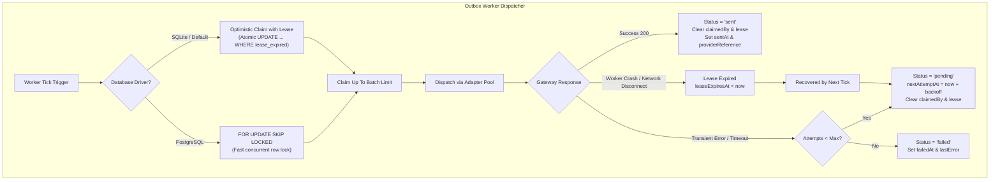

# SMS Transport & Durable Delivery Queue — Module Design Spec

- **Date:** 2026-11-22
- **Author:** Antigravity / Gemini 3.8 Flash (High)
- **Status:** Proposed (RFC)
- **Scope:** Runtime-agnostic core (`@nexload-sdk/sms`) + Payload CMS plugin (`@nexload-sdk/payload-sms`)
- **Authority:** Conforms to `docs/research/recurring-patterns/SPEC-BRIEF.md` (Fixed decisions 1–6, 9–10)

---

## 1. Problem & Empirical Evidence

### 1.1 The Recurring Problem
SMS delivery is implemented independently across virtually every Iranian e-commerce and operational platform. Each implementation repeatedly re-solves:
1. **Divergent gateway protocols:** Kavenegar uses `x-www-form-urlencoded` with query-based endpoints (`/v1/{apiKey}/verify/lookup.json`), while SMS.ir uses JSON with `X-API-KEY` headers (`/v1/send/verify` and `/v1/send/bulk`).
2. **Provider-specific input pitfalls:** Kavenegar rejects Persian zero-width non-joiner (`ZWNJ` / `\u200C`) and control characters with HTTP 431, enforces strict space limits (`token` forbids spaces; `token10` allows $\le 5$ spaces; `token20` allows $\le 8$ spaces).
3. **Delivery reliability gaps:** Notifications sent synchronously block user requests and fail on gateway latency; notifications queued in Postgres often rely exclusively on `FOR UPDATE SKIP LOCKED`, making local SQLite development or lightweight standalone runners impossible.
4. **Transaction leakages:** Enqueueing SMS inside database transactions causes "ghost notifications" if the transaction subsequently rolls back.
5. **OTP vs. Notification confusion:** Mixing high-priority synchronous OTP authentication with bulk notification queues causes delayed login codes during high-volume promotions.

### 1.2 Grounded Evidence Matrix

| Project | File Path | Mechanism Discovered | Quality & Deficiencies |
| :--- | :--- | :--- | :--- |
| **`gecut_picosms`** | [`src/sdk/kavenegar.ts`](file:///Users/mm25zamanian/Codes/_gh-mirror/gecut_picosms/src/sdk/kavenegar.ts#L30-L77) | Kavenegar SDK: `send()` (plain SMS) & `lookup()` (verify template). | Basic fetch client; strips falsy params; no phone normalization or space rules. |
| **`choobinooo.ir`** | [`apps/api/src/rpc/services/sms.service.ts`](file:///Users/mm25zamanian/Codes/choobinooo.ir/apps/api/src/rpc/services/sms.service.ts#L43-L191) | SMS.ir client: `/v1/send/verify` (OTP) & `/v1/send/bulk` (plain SMS). | Masks phone numbers in logs (`maskPhoneNumber`); parses message ID & cost; synchronous only. |
| **`cloud-app`** | [`apps/server/src/modules/notifications/services/kavenegar.service.ts`](file:///Users/mm25zamanian/Codes/cloud-app/apps/server/src/modules/notifications/services/kavenegar.service.ts#L12-L106) | Kavenegar OTP: `sendOtp()` via verify lookup endpoint. | Good phone masking (`0912***34`); NestJS-coupled; lacks outbox delivery tracking. |
| **`persianpartshop.ir`** | [`apps/cms/src/collections/sms-queue/sms-queue.collection.ts`](file:///Users/mm25zamanian/Codes/persianpartshop.ir/apps/cms/src/collections/sms-queue/sms-queue.collection.ts#L6-L122)<br>[`apps/cms/src/modules/sms/queue-worker.ts`](file:///Users/mm25zamanian/Codes/persianpartshop.ir/apps/cms/src/modules/sms/queue-worker.ts#L29-L102)<br>[`apps/cms/src/modules/sms/kavenegar-client.ts`](file:///Users/mm25zamanian/Codes/persianpartshop.ir/apps/cms/src/modules/sms/kavenegar-client.ts#L6-L161)<br>[`apps/cms/src/lib/committed-sms.ts`](file:///Users/mm25zamanian/Codes/persianpartshop.ir/apps/cms/src/lib/committed-sms.ts#L14-L93) | Durable SMS queue collection, background tick worker, transactional `sendAfterCommit`, token sanitizer stripping ZWNJ (`\u200C`) and enforcing space caps (`token10`, `token20`). | High quality, but worker hardcodes PostgreSQL (`if (payload.db.name !== 'postgres') throw ...`); cannot run on SQLite; Kavenegar-only. |
| **`nexload-e-commerce`** | [`apps/cms/src/jobs/sms-delivery.task.ts`](file:///Users/mm25zamanian/Codes/nexload-e-commerce/apps/cms/src/jobs/sms-delivery.task.ts#L44-L206)<br>[`apps/cms/src/jobs/sms-delivery.ts`](file:///Users/mm25zamanian/Codes/nexload-e-commerce/apps/cms/src/jobs/sms-delivery.ts#L27-L70)<br>[`packages/schema/src/notifications/notification-delivery.entity.ts`](file:///Users/mm25zamanian/Codes/nexload-e-commerce/packages/schema/src/notifications/notification-delivery.entity.ts#L21-L101)<br>[`packages/schema/src/notifications/notification-delivery-retry.ts`](file:///Users/mm25zamanian/Codes/nexload-e-commerce/packages/schema/src/notifications/notification-delivery-retry.ts#L31-L100) | `NotificationDelivery` entity, exponential backoff retry planner (`planNotificationDeliveryRetry`), Postgres `FOR UPDATE SKIP LOCKED`, stale claim recovery. | Robust state machine and retry logic; coupled to PostgreSQL Drizzle transactions and external HTTP relay. |
| **`rasad-srm`** | [`apps/cms/src/integrations/sms/types.ts`](file:///Users/mm25zamanian/Codes/rasad-srm/apps/cms/src/integrations/sms/types.ts#L6-L30)<br>[`apps/cms/src/integrations/sms/mockProvider.ts`](file:///Users/mm25zamanian/Codes/rasad-srm/apps/cms/src/integrations/sms/mockProvider.ts#L18-L97)<br>[`apps/cms/src/domain/sms/send-sms-task.ts`](file:///Users/mm25zamanian/Codes/rasad-srm/apps/cms/src/domain/sms/send-sms-task.ts#L13-L97) | Clean `ISmsProvider` interface (`sendSms`, `sendPatternSms`), in-memory `SimulatedSmsProvider` with message capture and failure injection. | Clean provider abstraction; Payload Background Task integration; missing durable outbox recovery. |
| **Research Reports** | `reports/B1.md`, `B2.md`, `B3.md`, `B5.md`, `B6.md` in `docs/research/recurring-patterns/` | Cross-project synthesis confirming Kavenegar and SMS.ir as the two dominant Iranian SMS gateways. | Confirmed: FarazSMS/IPPanel lacked active source files; Kavenegar and SMS.ir represent >90% of local production usage. |

---

## 2. Goals, Non-Goals, and Anti-Goals

### 2.1 Goals
- **Two decoupled packages:**
  1. `@nexload-sdk/sms`: Runtime-agnostic core (Node.js & Bun), zero Payload dependencies, shipping pure TypeScript interfaces, provider adapters (Kavenegar, SMS.ir, Mock, Console), phone normalization, and token sanitization.
  2. `@nexload-sdk/payload-sms`: Payload CMS v3 plugin providing durable outbox collections (`sms-messages`), background worker processing, transactional hooks (`sendAfterCommit`), and Admin UI dashboards.
- **Provider Parity:** Full support for both **pattern-based verification/notifications** (`lookup`/`verify`) and **plain text / bulk SMS** across Kavenegar, SMS.ir, Mock, and Console providers.
- **Dual-Engine Queue Claim:** High-performance `FOR UPDATE SKIP LOCKED` for PostgreSQL production, paired with a portable **optimistic lease claim** (`claimedBy` + `leaseExpiresAt`) that runs natively on SQLite for local development and CI.
- **At-Least-Once Delivery Semantics:** Guaranteed dispatch with deterministic idempotency keys passed to supporting gateways or tracked locally to prevent duplicate dispatches during worker crashes.
- **Synchronous vs. Queued Separation:** Direct synchronous `send` path for external callers (such as high-priority OTP modules) alongside durable asynchronous outbox processing for notifications.
- **Post-Commit Enqueueing:** Transaction-aware enqueueing ensuring SMS messages are dispatched only after enclosing database transactions commit.

### 2.2 Non-Goals
- **OTP Challenge State & Logic:** Phone OTP generation, hashing, rate limiting, and verification belong to a dedicated `@nexload-sdk/auth-otp` package.
- **Message Content Composition:** Translating business events (e.g. order placed) into localized copy or selecting templates is owned by the host application or notification projector.
- **CMS Template Management:** Defining SMS templates inside CMS UI is out of scope; templates are pre-approved in upstream provider portals.
- **Unverified Gateway Adapters:** IPPanel, FarazSMS, and Ghasedak are excluded from v1 until verified production contracts are provided.

### 2.3 Anti-Goals
- **Queueing OTP Codes:** Queueing OTP logins through a cron worker introduces unacceptable latency (10–60s). OTP must use synchronous execution.
- **Postgres Lock Exclusivity:** Requiring PostgreSQL native constructs for all queue operations, which breaks SQLite integration tests and developer local setups.
- **Logging Secrets or Raw OTPs:** Printing API keys, auth tokens, unmasked phone numbers, or cleartext OTP codes to console or files.

---

## 3. Package Layout & Public API

### 3.1 `@nexload-sdk/sms` (Core Runtime-Agnostic Package)

```text
packages/sms/
├── src/
│   ├── index.ts                 # Main entrypoint: core contracts, factory, utilities
│   ├── types.ts                 # ISmsProvider, SendParams, Result, Errors
│   ├── normalize.ts             # Phone normalization & token sanitization
│   ├── retry.ts                 # Exponential backoff retry planner
│   ├── providers/
│   │   ├── kavenegar.ts         # Kavenegar HTTP adapter
│   │   ├── sms-ir.ts            # SMS.ir HTTP adapter
│   │   ├── mock.ts              # In-memory test adapter with inspection
│   │   └── console.ts           # Development stdout logging adapter
│   └── errors.ts                # Normalized error taxonomy
├── esbuild.config.mjs           # ESM + CJS bundle targets (Node >=20.9.0 & Bun)
└── package.json
```

#### Package Subpath Exports
- `@nexload-sdk/sms` (pure types, normalization, factory, errors)
- `@nexload-sdk/sms/kavenegar` (Kavenegar adapter)
- `@nexload-sdk/sms/sms-ir` (SMS.ir adapter)
- `@nexload-sdk/sms/mock` (Simulated test provider)
- `@nexload-sdk/sms/testing` (Contract test suites for custom adapters)

#### Public TypeScript Signatures

```typescript
// types.ts
export type SmsProviderName = 'kavenegar' | 'sms-ir' | 'mock' | 'console' | (string & {});

export interface SendPlainSmsParams {
  recipient: string;
  message: string;
  sender?: string;
  idempotencyKey?: string;
  metadata?: Record<string, unknown>;
}

export interface SendPatternSmsParams {
  recipient: string;
  template: string;
  tokens: Record<string, string | number>;
  idempotencyKey?: string;
  metadata?: Record<string, unknown>;
}

export interface SmsSendResult {
  success: boolean;
  provider: SmsProviderName;
  messageId: string;
  cost?: number;
  rawResponse?: unknown;
}

export interface ISmsProvider {
  readonly name: SmsProviderName;
  sendPlain(params: SendPlainSmsParams, signal?: AbortSignal): Promise<SmsSendResult>;
  sendPattern(params: SendPatternParams, signal?: AbortSignal): Promise<SmsSendResult>;
}

export interface SmsRetryPolicy {
  initialDelayMs: number;    // default: 30_000 (30s)
  maxDelayMs: number;        // default: 3_600_000 (1h)
  maxAttempts: number;       // default: 5
  backoffMultiplier: number; // default: 2
  leaseDurationMs: number;   // default: 120_000 (2m)
}

export interface RetryDecision {
  action: 'retry' | 'fail' | 'unchanged';
  nextAttemptAt?: Date;
  reason?: string;
}

export function planSmsRetry(
  attempts: number,
  lastError: string,
  policy?: Partial<SmsRetryPolicy>
): RetryDecision;

export function normalizeIranianMobile(phone: string): string;
export function maskPhoneNumber(phone: string): string;
export function sanitizePatternTokens(
  tokens: Record<string, string | number>,
  options?: { allowSpacesInKeys?: string[] }
): Record<string, string>;
```

### 3.2 Gateway Contract Specifications

#### Kavenegar Implementation Details
- **Verify / Lookup (Pattern):**
  - **Endpoint:** `POST https://api.kavenegar.com/v1/{apiKey}/verify/lookup.json`
  - **Content-Type:** `application/x-www-form-urlencoded`
  - **Parameters:** `receptor`, `template`, `token`, `token2` (no spaces), `token10` ($\le 5$ spaces), `token20` ($\le 8$ spaces), `token3`.
  - **Sanitization Rule:** Zero-width characters (`\u200B-\u200D`, `\uFEFF`) and newlines/tabs MUST be stripped or space-collapsed to prevent gateway HTTP 431.
  - **Response Verification:** HTTP status 200 AND `data.return.status === 200`. Message ID extracted from `data.entries[0].messageid`.
- **Plain SMS Send:**
  - **Endpoint:** `POST https://api.kavenegar.com/v1/{apiKey}/sms/send.json`
  - **Parameters:** `receptor`, `message`, `sender` (optional).
  - **Response:** `data.entries[0].messageid`.

#### SMS.ir Implementation Details
- **Verify (Pattern):**
  - **Endpoint:** `POST https://api.sms.ir/v1/send/verify`
  - **Headers:** `X-API-KEY: {apiKey}`, `Content-Type: application/json`
  - **Body:** `{ mobile: string, templateId: number, parameters: Array<{ name: string, value: string }> }`
  - **Response Verification:** HTTP status 200 AND `data.status === 1`. Message ID from `data.data.messageId`.
- **Bulk / Plain SMS Send:**
  - **Endpoint:** `POST https://api.sms.ir/v1/send/bulk`
  - **Body:** `{ lineNumber: number, messageText: string, mobiles: string[] }`
  - **Response Verification:** `data.status === 1` AND `data.data.messageIds[0] > 0`.

---

## 4. Data Model (`sms-messages` Collection)

The `@nexload-sdk/payload-sms` package registers an authoritative collection: `sms-messages`.

```typescript
// collections/sms-messages.ts
import type { CollectionConfig } from 'payload';

export const SmsMessagesCollection: CollectionConfig = {
  slug: 'sms-messages',
  labels: {
    singular: 'پیامک خروجی',
    plural: 'پیامک‌های خروجی',
  },
  admin: {
    useAsTitle: 'recipient',
    defaultColumns: ['recipient', 'type', 'template', 'status', 'attempts', 'sentAt', 'createdAt'],
    group: 'ارتباطات و اعلان‌ها',
  },
  access: {
    read: ({ req }) => Boolean(req.user && req.user.role === 'admin'),
    create: () => false, // Only created via local API or plugin enqueue
    update: () => false, // Handled exclusively by worker and retry endpoint
    delete: ({ req }) => Boolean(req.user && req.user.role === 'superadmin'),
  },
  indexes: [
    { fields: ['status', 'nextAttemptAt'] },
    { fields: ['status', 'leaseExpiresAt'] },
    { fields: ['idempotencyKey'], unique: true },
    { fields: ['recipient'] },
  ],
  fields: [
    {
      name: 'recipient',
      type: 'text',
      required: true,
      index: true,
      label: 'شماره گیرنده',
      admin: { readOnly: true },
    },
    {
      name: 'type',
      type: 'select',
      required: true,
      defaultValue: 'pattern',
      options: [
        { label: 'الگومحور (Pattern)', value: 'pattern' },
        { label: 'متن ساده (Plain)', value: 'plain' },
      ],
      admin: { readOnly: true },
    },
    {
      name: 'template',
      type: 'text',
      label: 'نام الگو / شناسه قالب',
      admin: {
        readOnly: true,
        condition: (data) => data.type === 'pattern',
      },
    },
    {
      name: 'tokens',
      type: 'json',
      label: 'متغیرهای الگو',
      admin: {
        readOnly: true,
        condition: (data) => data.type === 'pattern',
      },
    },
    {
      name: 'message',
      type: 'textarea',
      label: 'متن پیامک',
      admin: {
        readOnly: true,
        condition: (data) => data.type === 'plain',
      },
    },
    {
      name: 'status',
      type: 'select',
      required: true,
      defaultValue: 'pending',
      index: true,
      options: [
        { label: 'در انتظار ارسال', value: 'pending' },
        { label: 'در حال پردازش (قفل)', value: 'processing' },
        { label: 'تحویل درگاه شد', value: 'sent' },
        { label: 'ناموفق نهایی', value: 'failed' },
      ],
      admin: { readOnly: true },
    },
    {
      name: 'attempts',
      type: 'number',
      required: true,
      defaultValue: 0,
      label: 'تعداد تلاش‌ها',
      admin: { readOnly: true },
    },
    {
      name: 'idempotencyKey',
      type: 'text',
      required: true,
      unique: true,
      index: true,
      label: 'کلید تکرارناپذیری',
      admin: { readOnly: true },
    },
    {
      name: 'provider',
      type: 'text',
      required: true,
      label: 'ارائه‌دهنده',
      admin: { readOnly: true },
    },
    {
      name: 'providerReference',
      type: 'text',
      index: true,
      label: 'شناسه پیگیری درگاه',
      admin: { readOnly: true },
    },
    {
      name: 'claimedBy',
      type: 'text',
      label: 'شناسه پردازنده (Worker ID)',
      admin: { readOnly: true },
    },
    {
      name: 'claimedAt',
      type: 'date',
      label: 'زمان دریافت کار',
      admin: { readOnly: true },
    },
    {
      name: 'leaseExpiresAt',
      type: 'date',
      index: true,
      label: 'پایان مهلت اجاره (Lease Expiry)',
      admin: { readOnly: true },
    },
    {
      name: 'nextAttemptAt',
      type: 'date',
      index: true,
      label: 'زمان تلاش بعدی',
      admin: { readOnly: true },
    },
    {
      name: 'lastError',
      type: 'textarea',
      label: 'آخرین خطا',
      admin: { readOnly: true },
    },
    {
      name: 'sentAt',
      type: 'date',
      label: 'زمان ارسال قطعی',
      admin: { readOnly: true },
    },
    {
      name: 'failedAt',
      type: 'date',
      label: 'زمان شکست قطعی',
      admin: { readOnly: true },
    },
  ],
};
```

---

## 5. Delivery Queue Engine & Execution Flows

### 5.1 Dual-Engine Outbox Claim Architecture



### 5.2 Numbered Execution Flows

#### Flow 1: Synchronous Direct Send (OTP / High-Priority)
1. **Initiation:** Host auth layer calls `smsCore.sendPattern(params)` directly with a short timeout (`AbortSignal.timeout(4_000)`).
2. **Phone Normalization:** `normalizeIranianMobile(phone)` normalizes `+98`, `0098`, Arabic/Persian digits to standard `09XXXXXXXXX`.
3. **Token Sanitization:** Strips control characters and zero-width non-joiners (`\u200C`).
4. **Direct Gateway Call:** Dispatches to Kavenegar or SMS.ir verify lookup endpoint.
5. **Result Handling:** Returns `SmsSendResult` containing `messageId`. Any error throws a normalized `SmsProviderError` immediately.
6. **Zero Queue Footprint:** No row is written to `sms-messages`, ensuring minimal database overhead and zero latency impact.

#### Flow 2: Transactional Enqueueing (`sendAfterCommit`)
1. **Business Transaction:** An order or registration begins inside a Payload Local API transaction (`req.transactionID`).
2. **Notification Enqueue:** The domain calls `smsPlugin.queueSms(req, { recipient, template, tokens, idempotencyKey })`.
3. **Outbox Persistence:** The message is inserted into `sms-messages` with status `'pending'` within the current database transaction.
4. **Post-Commit Guarantee:** If the transaction commits, the message is permanent. If the transaction rolls back, the message record is erased automatically.

#### Flow 3: Worker Claim, Lease, and Execution Flow
1. **Tick Trigger:** Background task or cron interval wakes up the queue runner.
2. **Claim Execution:**
   - **PostgreSQL Fast-Path:**
     ```sql
     WITH candidates AS (
       SELECT id FROM sms_messages
       WHERE (status = 'pending' AND next_attempt_at <= NOW())
          OR (status = 'processing' AND lease_expires_at <= NOW())
       ORDER BY created_at
       LIMIT 20
       FOR UPDATE SKIP LOCKED
     )
     UPDATE sms_messages AS m
     SET status = 'processing',
         attempts = m.attempts + 1,
         claimed_by = $workerId,
         claimed_at = NOW(),
         lease_expires_at = NOW() + INTERVAL '120 seconds',
         updated_at = NOW()
     FROM candidates
     WHERE m.id = candidates.id
     RETURNING m.id, m.recipient, m.type, m.template, m.tokens, m.message, m.attempts, m.idempotency_key;
     ```
   - **SQLite Portable Fallback:**
     Executes an optimistic claim loop using Payload Local API:
     ```typescript
     const candidates = await payload.find({
       collection: 'sms-messages',
       where: {
         or: [
           { and: [{ status: { equals: 'pending' } }, { nextAttemptAt: { less_than_equal: now } }] },
           { and: [{ status: { equals: 'processing' } }, { leaseExpiresAt: { less_than_equal: now } }] },
         ],
       },
       limit: batchSize,
       sort: 'createdAt',
     });
     // Atomically lock each candidate:
     for (const doc of candidates.docs) {
       const updated = await payload.db.drizzle.update(smsMessagesTable)
         .set({
           status: 'processing',
           attempts: doc.attempts + 1,
           claimedBy: workerId,
           claimedAt: now,
           leaseExpiresAt: new Date(Date.now() + leaseDurationMs),
         })
         .where(and(
           eq(smsMessagesTable.id, doc.id),
           or(
             eq(smsMessagesTable.status, 'pending'),
             lte(smsMessagesTable.leaseExpiresAt, now)
           )
         ));
     }
     ```
3. **Execution & Acknowledgment:**
   - Worker dispatches the message via the configured `ISmsProvider`.
   - On success: updates `status = 'sent'`, sets `sentAt = now()`, `providerReference = res.messageId`, clears `claimedBy` and `leaseExpiresAt`.
   - On gateway failure: updates `status = 'pending'`, sets `nextAttemptAt = now + backoffMs`, logs error code, clears `claimedBy`.
   - On max attempts reached: marks `status = 'failed'`, records `failedAt`.

---

## 6. Failure Modes and Recovery Table

| Failure Scenario | Detection Mechanism | System Behavior & Self-Healing |
| :--- | :--- | :--- |
| **Worker Process Crash during Send** | Row remains in `status = 'processing'`, but `leaseExpiresAt <= now()`. | Next worker tick detects expired lease ($> 120\text{s}$), treats as stale claim, increments attempt counter, and schedules retry or terminal failure. |
| **Gateway Timeout ($> 5\text{s}$)** | `AbortSignal.timeout(5_000)` fires in adapter client. | Request terminates locally. Job status moved back to `pending` with exponential backoff ($30\text{s} \times 2^{\text{attempts}}$). |
| **Lost Local Ack (Sent upstream, died before DB write)** | Upstream accepted message; process crashed before updating `sms-messages` to `'sent'`. | Upon lease expiry, job is reclaimed. If the gateway supports idempotency keys, the retry returns the existing message ID. If not, at-least-once delivery policy sends a second message rather than losing critical notification. |
| **Persian Text HTTP 431 (ZWNJ / Control Chars)** | Gateway returns HTTP 431 or 400 error. | Adapter normalizer pre-emptively sanitizes strings (`\u200B-\u200D` stripped, space constraints enforced). If rejected, recorded as non-retryable format error. |
| **Rate Limit / Credit Exhaustion (HTTP 429 / Low Credit)** | Gateway response code indicating quota limit. | Job moved to `pending` with extended delay ($10\text{ minutes}$). Admin alert logged via `@nexload-sdk/logger` with alert level. |
| **Concurrent Workers Pick Same Row** | Two workers run ticks simultaneously on SQLite. | Atomic conditional update (`WHERE status = 'pending' OR lease_expires_at <= now`) ensures exactly one worker updates the row; the second worker affects 0 rows and moves to next item. |

---

## 7. Configuration Surface

```typescript
export interface PayloadSmsConfig {
  /** SMS Transport Provider */
  provider: ISmsProvider;

  /** Number of messages claimed per tick (default: 20) */
  batchSize?: number;

  /** Concurrency lane limit within single worker process (default: 3) */
  concurrency?: number;

  /** Worker tick interval in milliseconds (default: 10_000 [10s]) */
  pollIntervalMs?: number;

  /** Lease time before a processing message is considered stale (default: 120_000 [2m]) */
  leaseDurationMs?: number;

  /** Retry policy parameters */
  retryPolicy?: Partial<SmsRetryPolicy>;

  /** If true, worker is not started automatically (useful for custom runner or test) */
  disableWorker?: boolean;
}
```

### Environment Variables Matrix

| Variable Name | Type | Default | Description |
| :--- | :--- | :--- | :--- |
| `SMS_PROVIDER` | `'kavenegar' \| 'sms-ir' \| 'mock' \| 'console'` | `'console'` | Active gateway adapter. |
| `KAVENEGAR_API_KEY` | `string` | `undefined` | Kavenegar REST API key (redacted in logs). |
| `SMSIR_API_KEY` | `string` | `undefined` | SMS.ir API key. |
| `SMSIR_LINE_NUMBER` | `number` | `undefined` | SMS.ir default sending line number. |
| `SMS_DISABLE_DELIVERY` | `boolean` | `false` | Disables outbound gateway requests (logs only). |
| `SMS_LOG_BODIES` | `boolean` | `false` | Whether to log message bodies (strictly never logs OTP). |

---

## 8. Security, Privacy, and Redaction

1. **Mandatory Phone Redaction:**
   All logs emitted by `@nexload-sdk/logger` must pass phone numbers through `maskPhoneNumber`:
   - Input: `09123456789` $\rightarrow$ Output: `0912***89`
2. **Credential Sanitization:**
   API keys are validated by the host app (for example with `@t3-oss/env-core`) and stripped from all error causes, traces, and outgoing HTTP log metadata.
3. **Zero OTP Logging Invariant:**
   OTP codes passed to synchronous verify endpoints MUST NEVER be written to application logs, disk, or the `sms-messages` database collection.
4. **Tenant & Role-Based Access Isolation:**
   The `sms-messages` collection denies all public/anonymous create, read, update, and delete access. Only authenticated users with `role: 'admin'` or `role: 'superadmin'` may view dispatch logs.

---

## 9. Migration Guide for Existing Codebases

### 9.1 Migrating `persianpartshop.ir`

#### Files Replaced / Removed:
- Replaced: `apps/cms/src/collections/sms-queue/sms-queue.collection.ts` $\rightarrow$ Replaced by plugin's `sms-messages`.
- Removed: `apps/cms/src/modules/sms/queue-worker.ts` $\rightarrow$ Handled by `@nexload-sdk/payload-sms` built-in runner.
- Removed: `apps/cms/src/modules/sms/kavenegar-client.ts` $\rightarrow$ Replaced by `@nexload-sdk/sms/kavenegar`.
- Migrated: `apps/cms/src/lib/committed-sms.ts` $\rightarrow$ Uses plugin's standardized `sendAfterCommit`.

#### Migration Code in `apps/cms/src/payload.config.ts`:
```typescript
import { buildConfig } from 'payload';
import { payloadSms } from '@nexload-sdk/payload-sms';
import { KavenegarAdapter } from '@nexload-sdk/sms/kavenegar';

export default buildConfig({
  // ...
  plugins: [
    payloadSms({
      provider: new KavenegarAdapter({
        apiKey: process.env.KAVENEGAR_API_KEY!,
      }),
      batchSize: 20,
      concurrency: 3,
    }),
  ],
});
```

### 9.2 Migrating `rasad-srm`

#### Files Replaced / Removed:
- Removed: `apps/cms/src/integrations/sms/types.ts` $\rightarrow$ Uses `@nexload-sdk/sms` interfaces.
- Removed: `apps/cms/src/integrations/sms/mockProvider.ts` $\rightarrow$ Uses `@nexload-sdk/sms/mock`.
- Replaced: `apps/cms/src/domain/sms/send-sms-task.ts` $\rightarrow$ Uses plugin's `queueSms` instead of custom Payload Task.

### 9.3 Migrating `nexload-e-commerce`

#### Files Replaced / Removed:
- Removed: `apps/cms/src/jobs/sms-delivery.ts` and `apps/cms/src/jobs/sms-delivery.task.ts`.
- Replaced: `packages/schema/src/notifications/notification-delivery-retry.ts` $\rightarrow$ Uses `planSmsRetry` from `@nexload-sdk/sms`.

---

## 10. Comprehensive Verification & Test Plan

### 10.1 Unit & Contract Tests (`@nexload-sdk/sms`)
- **Adapter Contract Suite:** A parameterized test suite executed against `KavenegarAdapter`, `SmsIrAdapter`, and `MockSmsAdapter`. Ensures identical handling of success, timeout, 400 bad request, 401 unauthorized, and 429 rate limit.
- **Normalizer Tests:**
  - Persian/Arabic digit replacement: `۰۹۱۲۳۴۵۶۷۸۹` $\rightarrow$ `09123456789`.
  - Prefix stripping: `+989123456789`, `00989123456789`, `989123456789` $\rightarrow$ `09123456789`.
- **Sanitizer Tests:**
  - Token sanitization strips ZWNJ (`\u200C`) and control characters.
  - Verifies space enforcement on Kavenegar token variants (`token` vs `token10` vs `token20`).
- **Retry Planner Tests:**
  - Verifies exponential backoff delay bounds (`30s`, `60s`, `120s`, `240s`, capped at `maxDelayMs`).
  - Terminal failure returned when `attempts >= maxAttempts`.

### 10.2 Integration Tests (`@nexload-sdk/payload-sms`)
- **SQLite In-Memory Test Harness:** Runs against `@payloadcms/db-sqlite` with zero PostgreSQL dependencies.
- **Atomic Lease & Claim Test:** Spawns 3 simulated concurrent workers competing for 50 queued messages; verifies zero double-delivery and zero missed rows.
- **Crash & Stale Lease Recovery:** Injects a simulated process crash after claiming messages; verifies the next tick reclaims the expired lease and delivers the messages.
- **Transactional Rollback Test:** Enqueues message inside a transaction; rolls back transaction; verifies 0 rows added to `sms-messages`.

---

## 11. Open Questions for the Project Owner

1. **Retention and Purge Policy:** Should `sms-messages` retain successful (`sent`) messages indefinitely, or should the plugin include a configurable auto-purge cron (e.g., delete sent records older than 30 days) to prevent unbounded table growth?
2. **Provider Failover / Cascading:** Should v1 support an active-passive fallback (e.g., attempt Kavenegar first, failover to SMS.ir if HTTP 5xx or credit exhausted), or keep providers strictly isolated per installation?
3. **SMS.ir Token Mapping Contract:** SMS.ir uses named parameters (`{ name: 'Code', value: '12345' }`), whereas Kavenegar uses positional tokens (`token`, `token2`, `token10`). Currently the spec maps `tokens: Record<string, string>` positionally or by key name. Is a standardized parameter mapping schema preferred across both?
4. **Admin UI Resend Capability:** Should the Admin UI include a secure manual "Resend" button for failed messages that resets attempts and clears previous error states?
