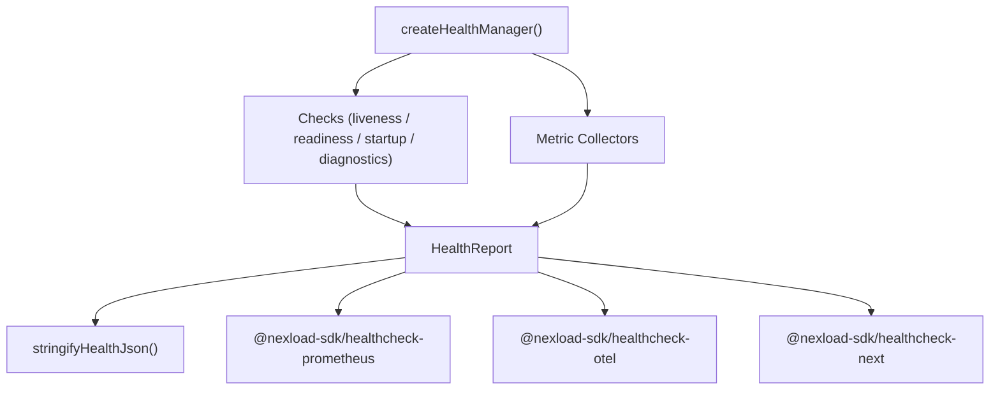

# @nexload-sdk/healthcheck

**Runtime-neutral health orchestration, timeout-safe check execution, and monitoring reports for production services.**

[Documentation](https://gecut.github.io/nexload-sdk/packages/healthcheck/core/) · [API reference](https://gecut.github.io/nexload-sdk/packages/healthcheck/core/api/)

[](https://www.npmjs.com/package/@nexload-sdk/healthcheck)


> [!IMPORTANT]
> A new major release is pending across the healthcheck family in `.changeset/healthcheck-major.md`: `@nexload-sdk/healthcheck` now re-exports `core/types` with `export type *`, so those types can only be used in type positions. Use `import type` (required under `verbatimModuleSyntax`). No runtime behavior changed.

## Table of contents

- [Overview](#overview)
- [Philosophy](#philosophy)
- [Install](#install)
- [Quick start](#quick-start)
- [Usage](#usage)
- [API](#api)
- [Configuration](#configuration)
- [Runtime and compatibility](#runtime-and-compatibility)
- [Caveats](#caveats)
- [Migration](#migration)
- [Related packages](#related-packages)
- [License](#license)

## Overview

`@nexload-sdk/healthcheck` runs health checks and metric collectors with per-check timeouts, `AbortSignal` cancellation, and thrown-error isolation, producing a deterministic `HealthReport` for Kubernetes probes, diagnostics, and monitoring exporters. It solves tightly coupled health endpoints, uncaught probe exceptions crashing reports, and dependency failures accidentally triggering process restarts. It is for service authors across Node.js, Bun, Next.js, and Edge runtimes.

What it is not:

- Does not start an HTTP server or register framework routes.
- Does not import Next.js, Payload, Prometheus, OpenTelemetry, Bun, `ping`, or `systeminformation`.
- Does not make database, cache, or HTTP failures fail liveness by default.
- Does not protect diagnostics routes; route protection belongs to your HTTP layer or `@nexload-sdk/healthcheck-next`.

## Philosophy

When modifying this package:

1. Keep the root package runtime-neutral and lightweight.
2. Do not import Payload, Next.js, Prometheus, OpenTelemetry, Bun, `ping`, or `systeminformation` from root.
3. `HealthManager.run()` must not reject because one check failed.
4. Every check receives an `AbortSignal`.
5. Every check result includes `observedAt` and `durationMs`.
6. Metrics should be raw numbers, booleans, strings, or null.
7. Dependency checks affect readiness, not liveness, by default.
8. Diagnostics must be protected.
9. Container limits must prefer cgroup v2/v1 over host OS values.
10. Prometheus labels must stay low-cardinality.

Built-in defaults avoid heavy diagnostics and high-cardinality metric labels.

- **Runtime-neutral core:** Zero external dependencies; runtime-specific probes live in separate adapter packages (`-node`, `-bun`, `-payload`).
- **Checks vs. collectors:** Checks determine aggregate health status (`ok`, `degraded`, `unhealthy`); collectors gather quantitative telemetry without altering status.
- **Fault isolation:** A thrown or timed-out check never rejects `health.run()`; every check receives an `AbortSignal` and records `observedAt` and `durationMs`.
- **Safe by default:** Public JSON (`toHealthJson`, `stringifyHealthJson`) suppresses error messages, causes, and details unless explicitly enabled.



## Install

```bash
pnpm add @nexload-sdk/healthcheck
# or
npm install @nexload-sdk/healthcheck
# or
yarn add @nexload-sdk/healthcheck
# or
bun add @nexload-sdk/healthcheck
```

Common integrations:

```bash
pnpm add @nexload-sdk/healthcheck-node
pnpm add @nexload-sdk/healthcheck-next
pnpm add @nexload-sdk/healthcheck-prometheus
pnpm add @nexload-sdk/healthcheck-payload payload
```

`payload` is an optional peer dependency of `@nexload-sdk/healthcheck-payload`; the root package does not depend on it.

| Package | Range | Required / Optional |
| --- | --- | --- |
| *(none)* | — | No peer dependencies |

## Quick start

```ts
import {
  createHealthManager,
  memoryCheck,
  runtimeInfoCheck,
  shutdownCheck,
  timerLagCheck,
} from "@nexload-sdk/healthcheck";

export const health = createHealthManager({
  service: { name: "api", version: process.env.APP_VERSION },
  runtime: "auto",
  checks: [
    shutdownCheck(),
    runtimeInfoCheck(),
    memoryCheck(),
    timerLagCheck(),
  ],
});

const report = await health.run("readiness");
console.log(report.status);
```

## Usage

### Node.js setup

<details>
<summary>Show example</summary>

```ts
import { createHealthManager, memoryCheck, shutdownCheck } from "@nexload-sdk/healthcheck";
import {
  containerMetricsCollector,
  containerResourceCheck,
  nodeRuntimeAdapter,
  processMetricsCollector,
} from "@nexload-sdk/healthcheck-node";

export const health = createHealthManager({
  service: { name: "api" },
  runtime: nodeRuntimeAdapter(),
  checks: [
    shutdownCheck(),
    memoryCheck(),
    containerResourceCheck({ scopes: ["diagnostics"] }),
  ],
  collectors: [
    processMetricsCollector(),
    containerMetricsCollector(),
  ],
});
```

</details>

### Bun setup

<details>
<summary>Show example</summary>

```ts
import { createHealthManager, shutdownCheck } from "@nexload-sdk/healthcheck";
import { bunRuntimeAdapter, bunServerMetricsCheck } from "@nexload-sdk/healthcheck-bun";

const server = Bun.serve({ fetch: () => new Response("ok") });

export const health = createHealthManager({
  service: { name: "bun-api" },
  runtime: bunRuntimeAdapter(),
  checks: [
    shutdownCheck(),
    bunServerMetricsCheck(server),
  ],
});
```

</details>

### Next.js App Router setup

<details>
<summary>Show example</summary>

Install:

```bash
pnpm add @nexload-sdk/healthcheck @nexload-sdk/healthcheck-node @nexload-sdk/healthcheck-next
```

Create `src/lib/health.ts`:

```ts
import { createHealthManager, memoryCheck, shutdownCheck, timerLagCheck } from "@nexload-sdk/healthcheck";
import { containerResourceCheck, nodeRuntimeAdapter } from "@nexload-sdk/healthcheck-node";

export const health = createHealthManager({
  service: {
    name: "web",
    version: process.env.NEXT_PUBLIC_APP_VERSION,
    environment: process.env.NODE_ENV,
  },
  runtime: nodeRuntimeAdapter(),
  checks: [
    shutdownCheck(),
    memoryCheck(),
    timerLagCheck(),
    containerResourceCheck({ scopes: ["diagnostics"] }),
  ],
});
```

Create `app/api/health/ready/route.ts`:

```ts
import { createNextHealthRoute } from "@nexload-sdk/healthcheck-next";
import { health } from "@/lib/health";

export const runtime = "nodejs";
export const dynamic = "force-dynamic";
export const revalidate = 0;
export const fetchCache = "force-no-store";

export const { GET, HEAD } = createNextHealthRoute(health, {
  scope: "readiness",
  format: "json",
});
```

Create a protected diagnostics route (configure the proxy to strip and set the trusted forwarding header):

```ts
import { createNextHealthRoute } from "@nexload-sdk/healthcheck-next";
import { health } from "@/lib/health";

export const runtime = "nodejs";
export const { GET, HEAD } = createNextHealthRoute(health, {
  scope: "diagnostics",
  format: "json",
  includeDetails: true,
  protect: {
    bearerToken: process.env.HEALTHCHECK_DIAGNOSTICS_TOKEN,
    trustProxy: true,
    allowCidrs: ["10.0.0.0/8", "172.16.0.0/12", "192.168.0.0/16"],
  },
});
```

</details>

### Docker and container resource detection

[healthcheck-node](../node/README.md) reads cgroup v2/v1 limits; its Node runtime memory adapter falls back to process and OS values when needed. `os.totalmem()` can describe the host rather than the container. Snapshots include memory current and limit bytes, usage ratio, CPU quota, cpuset CPUs, effective CPU count, cgroup version, source, and confidence.

### Monitoring exporters

<details>
<summary>Show example</summary>

Run `const report = await health.run("diagnostics")` with your configured manager before using these serializers.

JSON:

```ts
import { stringifyHealthJson } from "@nexload-sdk/healthcheck";

const body = stringifyHealthJson(report, { includeDetails: false, redact: true });
```

Prometheus/OpenMetrics:

```ts
import { toPrometheusText } from "@nexload-sdk/healthcheck-prometheus";

const text = toPrometheusText(report, { prefix: "nexload" });
```

Next.js metrics route:

```ts
import { createNextMetricsRoute } from "@nexload-sdk/healthcheck-next";
import { health } from "@/lib/health";

export const runtime = "nodejs";
export const dynamic = "force-dynamic";
export const revalidate = 0;
export const fetchCache = "force-no-store";

export const { GET } = createNextMetricsRoute(health, {
  format: "prometheus",
  scope: "all",
  prefix: "nexload",
});
```

OpenTelemetry-friendly transforms:

```ts
import { toOtelMetricRecords, toOtelResourceAttributes } from "@nexload-sdk/healthcheck-otel";

const records = toOtelMetricRecords(report);
const attributes = toOtelResourceAttributes(report);
```

</details>

### Payload integration

<details>
<summary>Show example</summary>

```ts
import { payloadHealthCheck } from "@nexload-sdk/healthcheck-payload";
import { getPayload } from "payload";
import config from "@payload-config";

const payload = await getPayload({ config });

const check = payloadHealthCheck(payload, {
  collection: "users",
  limit: 1,
  depth: 0,
});
```

Use a small deterministic collection. Payload is an optional peer dependency of the Payload package only.

</details>

### Scopes and Kubernetes probes

| Scope | Purpose | Dependency failures | Recommended route |
| --- | --- | --- | --- |
| `liveness` | Process should keep running | No, not by default | `/livez` |
| `readiness` | Service can receive traffic | Yes | `/readyz` |
| `startup` | Startup has completed | Yes | `/startupz` |
| `diagnostics` | Protected operational detail | Usually non-critical | `/diagnostics` (protected) |

Default HTTP status mapping (`DEFAULT_HTTP_STATUS_POLICY`): `ok -> 200`, `degraded -> 200`, `unhealthy -> 503`. Use `STRICT_READINESS_HTTP_STATUS_POLICY` to map `degraded -> 503`.

### Custom checks and collectors

```ts
import { defineHealthCheck } from "@nexload-sdk/healthcheck";

const licenseCheck = defineHealthCheck({
  name: "license",
  scopes: ["readiness", "diagnostics"],
  critical: true,
  async run(ctx) {
    const valid = await verifyLicense({ signal: ctx.signal });

    return ctx.result({
      status: valid ? "ok" : "unhealthy",
      metrics: { valid },
      error: valid
        ? undefined
        : { code: "LICENSE_INVALID", message: "License is not valid." },
    });
  },
});
```

### HTTP dependency checks and JSON serialization

```ts
import { httpCheck, stringifyHealthJson } from "@nexload-sdk/healthcheck";

const upstream = httpCheck("catalog-api", "https://catalog.internal/healthz", {
  timeoutMs: 1500,
});

// Public-safe JSON output:
const body = stringifyHealthJson(report, { includeDetails: false, redact: true });
```

### Troubleshooting error codes

- `CHECK_TIMEOUT`: The check exceeded its timeout or ignored cancellation.
- `CHECK_THROWN`: The check threw; the report stayed valid.
- `HEALTHCHECK_DEPENDENCY_UNAVAILABLE`: An HTTP dependency could not be reached.
- `HEALTHCHECK_ROUTE_UNAUTHORIZED`: A protected route rejected the request.
- `HEALTHCHECK_CONTAINER_LIMIT_UNAVAILABLE`: Container resource data could not be read.

## API

### Root entry (`@nexload-sdk/healthcheck`)

| Export | Kind | Summary |
| --- | --- | --- |
| `createHealthManager` | `function` | Creates a `HealthManager` instance |
| `defineHealthCheck` | `function` | Typed helper for defining checks |
| `defineMetricCollector` | `function` | Typed helper for defining collectors |
| `runtimeInfoCheck`, `shutdownCheck`, `startupCheck`, `timerLagCheck`, `memoryCheck`, `httpCheck` | `function` | Built-in runtime-neutral health checks |
| `runtimeMetricsCollector` | `function` | Built-in runtime metrics collector |
| `summarizeChecks`, `aggregateStatus` | `function` | Status aggregation and summary helpers |
| `statusToHttpStatus`, `DEFAULT_HTTP_STATUS_POLICY`, `STRICT_READINESS_HTTP_STATUS_POLICY` | `function` / `const` | HTTP status mapping |
| `toHealthJson`, `stringifyHealthJson` | `function` | Redacted JSON serialization |
| `genericRuntimeAdapter`, `autoRuntimeAdapter` | `function` | Runtime adapters |
| `createAbortSignal`, `sleep` | `function` | Timeout and cancellation utilities |
| `HEALTH_ERROR_CODES` / `HealthErrorCode` | `const` / `type` | Standard error code constants and union |
| `HealthManager`, `HealthReport`, `HealthScope`, `HealthStatus`, `RuntimeAdapter`, etc. | `type` | TypeScript types (`export type *`) |

## Configuration

`createHealthManager(options)` accepts:

| Option | Type | Default | Description |
| --- | --- | --- | --- |
| `service` | `ServiceIdentity` | Required | Service `{ name, version?, environment?, instanceId? }` |
| `runtime` | `RuntimeAdapter \| "auto"` | `"auto"` | Runtime adapter or `"auto"` detection |
| `environment` | `EnvironmentIdentity` | `undefined` | Optional deployment environment metadata |
| `defaults.timeoutMs` | `number` | `1000` | Default per-check timeout in milliseconds |
| `defaults.concurrency` | `number` | `8` | Maximum concurrent checks |
| `defaults.unhealthyOnTimeout` | `boolean` | `true` | Set `false` to mark timed-out checks `degraded` instead of `unhealthy` |
| `defaults.includeStack` | `boolean` | `false` | Include error stack traces in raw results |
| `defaults.profile` | `HealthDataProfile` | `"summary"` | Default context profile |
| `profiles` | Per-scope `HealthDataProfile` | `undefined` | Context hints for checks and collectors |
| `redaction` | Redaction options | `undefined` | Deprecated and ignored by the manager; pass `redaction` to `toHealthJson` or `stringifyHealthJson` instead |
| `checks` | `readonly HealthCheckDefinition[]` | `[]` | Initial checks to register |
| `collectors` | `readonly MetricCollectorDefinition[]` | `[]` | Initial collectors to register |

## Runtime and compatibility

- **Module format:** Dual ESM (`import`) and CJS (`require`).
- **Runtimes:** Node.js, Bun, Edge, and browsers.

## Caveats

> [!CAUTION]
> Never put database, cache, or external HTTP checks in `liveness` unless you intentionally want transient dependency failures to restart the process.

> [!WARNING]
> Public probe routes should return minimal data. Diagnostics and metrics can expose runtime versions, process metrics, dependency names, and failure details; protect them with authentication, private networking, IP allowlists, or reverse-proxy rules. Public JSON suppresses error messages and causes by default. Only enable `redaction.includeErrorMessage` or `includeDetails: true` on authenticated or private-network routes, and never expose environment variables, secrets, cookies, authorization headers, database URLs, connection strings, or raw stack traces.

> [!NOTE]
> `profiles` are context hints passed to checks and collectors; they do not filter report output automatically. Use `toHealthJson()` or `stringifyHealthJson()` to control response details.

## Migration

### Major release notes

- `HealthCheckType` is replaced by `HealthScope`.
- Class-based checks are replaced by `defineHealthCheck()` factories.
- `HealthManager` construction is replaced by `createHealthManager()`.
- `NetworkHealthCheck` is replaced by `httpCheck()` plus `@nexload-sdk/healthcheck-node` `tcpCheck()` and `dnsCheck()`.
- Payload integration moved to `@nexload-sdk/healthcheck-payload`.
- Core types are re-exported with `export type *` (type positions only; use `import type`, required under `verbatimModuleSyntax`).
- Root no longer depends on `payload`, `ping`, `systeminformation`, logger, or env packages.
- Metrics use raw numbers, booleans, or null where possible.

## Related packages

- [healthcheck-node](../node/README.md) — Node.js runtime, cgroup, TCP, and DNS probes
- [healthcheck-bun](../bun/README.md) — Bun runtime adapter and server metrics
- [healthcheck-next](../next/README.md) — Next.js App Router route handlers
- [healthcheck-prometheus](../prometheus/README.md) — Prometheus / OpenMetrics text serializer
- [healthcheck-otel](../otel/README.md) — OpenTelemetry resource and metric mappers
- [healthcheck-payload](../payload/README.md) — Payload CMS readiness check

## License

MIT
