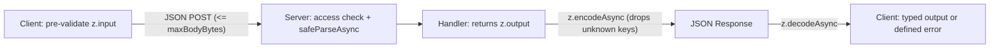

# @nexload-sdk/payload-operations

**Typed custom operations for Payload CMS with shared Zod contracts, secure server endpoints, and type-safe RPC clients.**

[Documentation](https://gecut.github.io/nexload-sdk/packages/payload-operations/) · [API reference](https://gecut.github.io/nexload-sdk/packages/payload-operations/api/)

[](https://www.npmjs.com/package/@nexload-sdk/payload-operations)


> [!IMPORTANT]
> Version 2.0.0 is pending in `.changeset/payload-operations-2.md`: `createCMSClient` moved to `./cms`, `timeoutPlugin` moved to `./plugins/timeout`, `access.default` is required on `createPayloadEndpoints`, output schemas must be codec-safe (`z.encodeAsync`), and `maxBodyBytes` defaults to `1_048_576` (1 MiB).

## Table of contents

- [Overview](#overview)
- [Philosophy](#philosophy)
- [Install](#install)
- [Quick start](#quick-start)
- [Usage](#usage)
- [API](#api)
- [Configuration](#configuration)
- [Runtime and compatibility](#runtime-and-compatibility)
- [Caveats](#caveats)
- [Migration](#migration)
- [Related packages](#related-packages)
- [License](#license)

## Overview

`@nexload-sdk/payload-operations` lets you define custom RPC-style operations once with Zod 4 schemas, mount them as Payload CMS REST endpoints on the server, and call them with full type safety from BFFs or browsers. It solves untyped custom Payload endpoints, accidental server-code leaks into client bundles, and unmodeled fields leaking in API responses. It is for Payload 3 teams building custom business actions alongside standard CRUD.

What it is not:

- Not a replacement for Payload collection CRUD (`find`, `create`, `update`, `delete`).
- Not a database transaction manager; handlers manage multi-step transactions explicitly.
- Not a retry or queue framework.

## Philosophy

- **Strict bundle boundaries:** Contracts (`./contract`), errors (`./errors`), and the standalone client (`./client`) never import `payload` or `@payloadcms/sdk`.
- **Fail-closed access control:** `createPayloadEndpoints` requires `access.default` and throws `TypeError: createPayloadEndpoints requires access.default.` at config time if omitted. The predicate receives `{ req, operation }`.
- **Codec-safe wire model:** Handlers return `z.output<output>` and the server encodes via `z.encodeAsync`, dropping unknown `z.object` keys so internal fields never leak.
- **Transforms run once on the server:** Clients pre-validate and send `z.input` over JSON; server `safeParseAsync` applies defaults and transforms once.



## Install

```bash
pnpm add @nexload-sdk/payload-operations payload zod
# Optional: only when using @nexload-sdk/payload-operations/cms
pnpm add @payloadcms/sdk
```

| Package | Range | Required / Optional |
| --- | --- | --- |
| `payload` | `>=3.85.0 <4.0.0` | Required (for `./server`) |
| `zod` | `>=4.1.0 <5.0.0` | Required |
| `@payloadcms/sdk` | `>=3.85.0 <4.0.0` | Optional (required only for `./cms`) |

## Quick start

```ts
import { defineCMSOperations, operation } from "@nexload-sdk/payload-operations";
import { z } from "zod";

export const appOperations = defineCMSOperations({
  inventory: {
    checkStock: operation({
      input: z.object({ sku: z.string().min(1) }),
      output: z.object({ available: z.int().nonnegative(), sku: z.string() }),
      errors: {
        SKU_NOT_FOUND: { message: "Requested SKU does not exist.", status: 404 },
        OUT_OF_STOCK: { data: z.object({ available: z.int().nonnegative() }), message: "Out of stock.", status: 409 },
      },
    }),
  },
});
```

## Usage

| Value | Wire behavior |
| --- | --- |
| Input | Client pre-validates with `safeParseAsync` for a fast 422, then sends input over JSON; server parses it. |
| Output | Server encodes with `z.encodeAsync`; client decodes with `z.decodeAsync`. |
| Defined error data | Server encodes with `z.encodeAsync`; client decodes with `z.decodeAsync`. |

Codec-safe output and error schemas include plain schemas, checks and overwrites such as `z.string().trim()`, and bidirectional `z.codec()` schemas.

### Mounting server endpoints (`./server`)

```ts
import { buildConfig } from "payload";
import { createPayloadEndpoints } from "@nexload-sdk/payload-operations/server";
import { appOperations } from "./operations";

const operationEndpoints = createPayloadEndpoints({
  operations: appOperations,
  basePath: "/api/operations",
  access: {
    default: ({ req }) => Boolean(req.user),
    overrides: {
      inventory: { checkStock: () => true },
    },
  },
  handlers: {
    inventory: {
      checkStock: async ({ input, errors }) => {
        if (input.sku === "UNKNOWN") throw errors.SKU_NOT_FOUND();
        if (input.sku === "EMPTY") throw errors.OUT_OF_STOCK({ data: { available: 0 } });
        return { available: 42, sku: input.sku };
      },
    },
  },
});

export default buildConfig({
  endpoints: [...operationEndpoints],
});
```

When `access` returns `false`, unauthenticated requests receive `401 UNAUTHORIZED` and authenticated requests receive `403 FORBIDDEN`.

### Pure RPC client (`./client`)

Zero dependency on `@payloadcms/sdk`:

```ts
import { createOperationsClient } from "@nexload-sdk/payload-operations/client";
import { isDefinedError, safe } from "@nexload-sdk/payload-operations";
import { appOperations } from "./operations";

const client = createOperationsClient({
  baseURL: "https://cms.example.com",
  basePath: "/api/operations",
  operations: appOperations,
});

const [error, result, isDefined] = await safe(
  client.inventory.checkStock({ sku: "ITEM-1" }),
);

if (isDefined && isDefinedError(error, "OUT_OF_STOCK")) {
  const available = error.data.available;
} else if (result) {
  // typed result
}
```

### Integrated CMS client (`./cms`)

Shares transport and credentials between native `PayloadSDK` and custom operations:

```ts
import { createCMSClient } from "@nexload-sdk/payload-operations/cms";
import { timeoutPlugin } from "@nexload-sdk/payload-operations/plugins/timeout";
import { appOperations } from "./operations";

const cms = createCMSClient({
  operations: appOperations,
  basePath: "/api/operations",
  payload: {
    baseURL: "https://cms.example.com",
    baseInit: { credentials: "include" },
  },
  plugins: [timeoutPlugin({ timeout: 5000 })],
});

const posts = await cms.payload.find({ collection: "posts" });
const stock = await cms.operations.inventory.checkStock({ sku: "ITEM-1" });
```

### Bidirectional `Date` handling with `z.codec`

```ts
import { operation } from "@nexload-sdk/payload-operations/contract";
import { z } from "zod";

export const dateCodec = z.codec(z.iso.datetime(), z.date(), {
  decode: (iso) => new Date(iso),
  encode: (date) => date.toISOString(),
});

export const orderOperation = operation({
  input: z.object({ orderId: z.string() }),
  output: z.object({ createdAt: dateCodec, orderId: z.string() }),
});
```

## API

| Subpath | Key exports | Target |
| --- | --- | --- |
| `@nexload-sdk/payload-operations` | `defineCMSOperations`, `operation`, `safe`, `isDefinedError`, `isTimeoutError`, contract & error types | Universal |
| `@nexload-sdk/payload-operations/contract` | `defineCMSOperations`, `operation`, contract types | Universal |
| `@nexload-sdk/payload-operations/errors` | `CMSOperationError`, `isCMSOperationError`, `isDefinedError`, `safe`, error types | Universal |
| `@nexload-sdk/payload-operations/client` | `createOperationsClient`, `defineClientPlugin`, client transport types | Universal |
| `@nexload-sdk/payload-operations/cms` | `createCMSClient`, `createPayloadFetchAdapter`, CMS client types | Universal (requires `@payloadcms/sdk`) |
| `@nexload-sdk/payload-operations/plugins/timeout` | `timeoutPlugin`, `isTimeoutError`, `TimeoutPluginOptions` | Universal |
| `@nexload-sdk/payload-operations/server` | `createPayloadEndpoints`, `CMSOperationError`, `DEFAULT_MAX_BODY_BYTES`, server types | Node.js / Payload Server only |

## Configuration

`createPayloadEndpoints(options)` accepts:

| Option | Type | Default | Description |
| --- | --- | --- | --- |
| `operations` | `CMSOperationsTree` | Required | Operations contract tree from `defineCMSOperations` |
| `handlers` | `CMSOperationHandlers` | Required | Server handler implementations matching `operations` |
| `access` | `{ default: CMSOperationAccess; overrides?: ... }` | Required (`access.default`) | Default access predicate and optional per-operation overrides |
| `basePath` | `string` | `"/operations"` | Base URL path where endpoints are mounted |
| `maxBodyBytes` | `number` | `1_048_576` (1 MiB) | Maximum request body size; larger payloads return `413 PAYLOAD_TOO_LARGE` |

`maxBodyBytes` must be a positive integer; for example, set `maxBodyBytes: 5_242_880` for 5 MiB. The server checks `Content-Length` before buffering and counts bytes while streaming. Invalid values throw `TypeError("maxBodyBytes must be a positive integer.")`.

## Runtime and compatibility

- **Module format:** ESM-only (`type: "module"`).
- **Node.js:** `>=20.9.0` for `./server`.
- **Universal subpaths:** Root, `./contract`, `./errors`, `./client`, `./cms`, and `./plugins/timeout` run in Node.js, Bun, Edge, and browsers.
- **Peers:** `payload >=3.85.0 <4.0.0`, `zod >=4.1.0 <5.0.0`, optional `@payloadcms/sdk >=3.85.0 <4.0.0`.

## Caveats

> [!WARNING]
> Unidirectional `.transform()` calls in `output` or defined-error `data` schemas cannot be inverted by `z.encodeAsync` and cause the server to return `500 INTERNAL_SERVER_ERROR`. Use `.overwrite()` or `z.codec()` instead.

> [!CAUTION]
> Inside server handlers, `req.payload` Local API calls default to `overrideAccess: true` in Payload 3. Pass `{ overrideAccess: false, req }` explicitly when collection-level access control must be enforced for the caller.

> [!NOTE]
> `z.object` drops unrecognized keys during `z.encodeAsync`. This prevents extra properties such as password hashes or internal IDs from leaking. Use `z.looseObject(...)` or `.passthrough()` if you intentionally want extra properties preserved on the wire.

## Migration

### From 1.x to 2.0

- Import `createCMSClient` from `@nexload-sdk/payload-operations/cms` instead of root or `./client`.
- Import `timeoutPlugin` from `@nexload-sdk/payload-operations/plugins/timeout` instead of root.
- Provide `access.default` in `createPayloadEndpoints` (omitting it now throws `TypeError`).
- Replace unidirectional `.transform()` in output/error schemas with `z.codec` or `.overwrite()`.
- Requests over 1 MiB now return `413 PAYLOAD_TOO_LARGE`; set `maxBodyBytes` if you need larger bodies.
- Clients now send the original `z.input` value; input transforms and defaults run on the server. Client pre-validation also parses the input.
- Upgrade `zod` to `>=4.1.0 <5.0.0`. `@payloadcms/sdk` is now optional unless using `./cms`.

## Related packages

- [payload-schema](../payload-schema/README.md) — Codec-safe entity schemas that compose with operation outputs
- [payload-hooks](../payload-hooks/README.md) — Collection audit logging for Payload

## License

MIT
