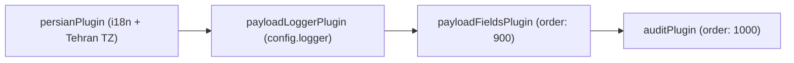

# @nexload-sdk/payload-preset

**Composed Payload CMS preset for Persian admin defaults, SDK logger bridging, field hooks, and audit logging.**

[](https://www.npmjs.com/package/@nexload-sdk/payload-preset)


> [!IMPORTANT]
> Version 1.0.0 is pending initial release in `.changeset/payload-preset-initial.md` and is not published to npm yet.

## Table of contents

- [Overview](#overview)
- [Philosophy](#philosophy)
- [Install](#install)
- [Quick start](#quick-start)
- [Usage](#usage)
- [API](#api)
- [Configuration](#configuration)
- [Runtime and compatibility](#runtime-and-compatibility)
- [Caveats](#caveats)
- [Related packages](#related-packages)
- [License](#license)

## Overview

`@nexload-sdk/payload-preset` bundles four Nexload Payload plugins behind a single `nexloadPreset()` call: `persianPlugin()`, `payloadLoggerPlugin()`, `payloadFieldsPlugin()`, and `auditPlugin()`. It solves repetitive top-level `buildConfig()` wiring across Payload CMS projects targeting Persian/Iranian setups. It is for Payload 3 server configurations running on Node.js.

What it is not:

- Not a collection or field schema generator (use `@nexload-sdk/payload-fields` and `@nexload-sdk/payload-schema`).
- Not an admin branding or font package; set `admin.components.graphics.Logo`, `Icon`, and fonts in your host app.
- Not a localization enabler; `persianPlugin()` never adds `localization.locales` or enables document localization on its own.

## Philosophy

Audit logs identifiers and counts, not bodies, emails, or tokens; read auditing is off by default. `getPayloadLoggerConfig()` supplies SDK redaction, serializers, request context, formatting, and any explicit destination to Payload’s logger.

- **Merge, never overwrite:** `persianPlugin()` and `payloadLoggerPlugin()` preserve host-configured languages, timezones, and `config.logger`.
- **Top-level config only:** Plugins adjust `i18n`, `admin.timezones`, `logger`, existing `fa` locale objects (`rtl`), collection and global hooks, and add the `/payload-fields/generate-slug` endpoint without mutating field definitions.
- **Explicit plugin ordering:** `payloadFieldsPlugin` (`900`) and `auditPlugin` (`1000`) run after default-order plugins so collections added by other plugins are covered.



## Install

```bash
pnpm add @nexload-sdk/payload-preset payload @payloadcms/translations
# or
npm install @nexload-sdk/payload-preset payload @payloadcms/translations
# or
yarn add @nexload-sdk/payload-preset payload @payloadcms/translations
# or
bun add @nexload-sdk/payload-preset payload @payloadcms/translations
```

| Package | Range | Required / Optional |
| --- | --- | --- |
| `payload` | `>=3.85.0 <4.0.0` | Required |
| `@payloadcms/translations` | `>=3.85.0 <4.0.0` | Required |

## Quick start

```ts
import { configureLogger } from "@nexload-sdk/logger";
import { nexloadPreset } from "@nexload-sdk/payload-preset";
import { buildConfig } from "payload";

configureLogger({ service: "shop-cms" }); // Must run before buildConfig()

export default buildConfig({
  // Add db, secret, and collections here.
  plugins: [...nexloadPreset()],
});
```

## Usage

### Customizing or disabling preset plugins

Pass `false` to disable any individual plugin, or pass options directly to `fields` or `audit`:

```ts
import { nexloadPreset } from "@nexload-sdk/payload-preset";

export const plugins = nexloadPreset({
  persian: true,
  logger: true,
  fields: {
    generateSlugAccess: ({ req }) => Boolean(req.user),
  },
  audit: {
    operations: ["create", "update", "delete", "auth"],
  },
});
```

### Composing individual plugins

You can also import `persianPlugin` and `payloadLoggerPlugin` directly without `nexloadPreset()`:

```ts
import { payloadLoggerPlugin, persianPlugin } from "@nexload-sdk/payload-preset";

export const plugins = [persianPlugin(), payloadLoggerPlugin()];
```

### Admin branding and fonts (DIY)

- **Branding:** Set Payload's `admin.components.graphics.Logo` and `admin.components.graphics.Icon` to your own component paths in `buildConfig`.
- **Fonts:** Load your font in `app/(payload)/layout.tsx` and apply its class to the Payload layout in your host app.

## API

### Root entry (`@nexload-sdk/payload-preset`)

| Export | Kind | Summary |
| --- | --- | --- |
| `nexloadPreset` | `function` | Returns `Plugin[]` combining Persian, logger, fields, and audit plugins |
| `persianPlugin` | `function` | Adds `fa` translation support, `Asia/Tehran` timezone, and `fa` RTL defaults |
| `payloadLoggerPlugin` | `function` | Applies `getPayloadLoggerConfig()` when `config.logger` is `undefined` |
| `NexloadPresetOptions` | `type` | Options object accepted by `nexloadPreset` |
| `AuditOperation` | `type` | Re-exported from `@nexload-sdk/payload-hooks` |
| `AuditPluginOptions` | `type` | Re-exported from `@nexload-sdk/payload-hooks` |

## Configuration

| Option | Type | Default | Description |
| --- | --- | --- | --- |
| `persian` | `boolean` | `true` | Enables `persianPlugin()` |
| `logger` | `boolean` | `true` | Enables `payloadLoggerPlugin()` when `config.logger` is unset |
| `fields` | `false \| PayloadFieldsPluginOptions` | `{}` | Options for `payloadFieldsPlugin`, or `false` to disable |
| `audit` | `false \| AuditPluginOptions` | `{}` | Options for `auditPlugin`, or `false` to disable |

## Runtime and compatibility

- **Module format:** ESM-only (`type: "module"`).
- **Runtime:** Node.js Payload configuration only.
- **Payload version:** `payload` and `@payloadcms/translations` `>=3.85.0 <4.0.0`.

## Caveats

> [!WARNING]
> Call `configureLogger()` **before** `buildConfig()`. `payloadLoggerPlugin()` only forwards an explicit `destination` stream, so in development Payload writes JSON unless `configureLogger({ destination })` is provided. Payload's logger uses standard Pino levels and has no `success()` method; the SDK's `success` threshold maps to `warn`. Forced SDK reconfigurations require rebuilding the Payload config.

> [!WARNING]
> Payload creates its implicit default `users` auth collection after plugins run, so `auditPlugin` cannot target it. Declare your auth collection explicitly to audit auth and write events, and note that write hooks fire before transaction commit, so an audit entry may describe a change that was rolled back and did not persist (see [payload-hooks](../payload-hooks/README.md)).

> [!NOTE]
> `persianPlugin()` only sets `rtl: true` on existing `fa` locale objects that leave `rtl` undefined; string-array locales and existing `rtl` values are left untouched.

## Related packages

- [logger](../logger/README.md) — Global structured logger bridged by `payloadLoggerPlugin`
- [payload-fields](../payload-fields/README.md) — Field factories and `payloadFieldsPlugin` (`order: 900`)
- [payload-hooks](../payload-hooks/README.md) — Collection `auditPlugin` (`order: 1000`)
- [persian](../persian/README.md) — Provides `TEHRAN_TIME_ZONE`

## License

MIT
